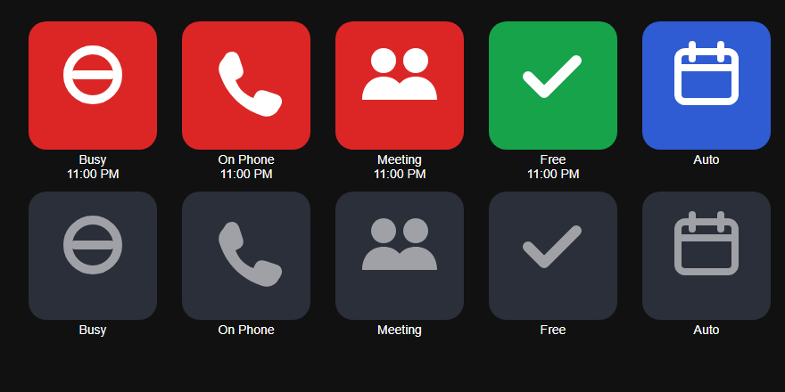

# Stream Deck Plugin: Akashic Display Busy

Set your Akashic Display room (a home office busy light, a door sign, a meeting room) to
**Busy**, **On the Phone**, **In a Meeting**, **Available** or **Auto** from an Elgato
Stream Deck, and see on the keys what it is now, whoever set it: you, your calendar,
another key or your phone.

> [!WARNING]
> **Use at your own risk. There is no warranty of any kind** (see the [licence](../LICENSE)).
> This plugin has been tested on a computer only, not yet in the Stream Deck app on a real
> device. Treat your first install as a trial.



## What You Need

- Stream Deck 7.1 or later, on Windows 10+ or macOS 12+.
- An Akashic Display room with a **status key**: in your dashboard's **/admin → Rooms**,
  choose the room and **Make A Key**. The key is shown once; copy it. Anyone with it can
  change that room, so keep it private (you can replace or revoke it there).

## Install

1. Download `io.github.cyamato.akashicbusy.streamDeckPlugin` from this repository's
   [Releases](https://github.com/cyamato/akashic-display-diy/releases), or build it yourself (below).
2. Double-click it; Stream Deck installs it. The actions are under **Akashic Display Busy**.

## Set Up

1. Drag **Set Status** or **Toggle** onto a key.
2. In the key's settings, enter your **Server** (for example `https://dash.example.com`) and
   the room's **Status Key**. They're shared by every key of this plugin, so you enter
   them once.
3. For **Set Status**, choose what it **Sets** and **For** how long. Make one key per
   state, for example On the Phone, In a Meeting and Available.

| Action | Pressing it | The key shows |
| --- | --- | --- |
| **Set Status** | Sets its state for the chosen time (Auto: back to the room's calendar). | Lit in its colour, with the end time, while the room is in its state. |
| **Toggle** | Steps to the next: Available, On the Phone, In a Meeting, Busy, Auto. | The room's state now, in its colour. |

Keys check the room every 10 seconds, and at once after your computer wakes. A key that
says **Set Up** needs the server and key; a key that flashes a warning couldn't reach the
server or was refused (check the address and the key).

## Build It Yourself

Needs Node.js 20.5 or later.

```sh
npm ci
npm test            # the logic's tests, with coverage
npm run build       # bundles io.github.cyamato.akashicbusy.sdPlugin/bin/plugin.js
npm run validate    # Elgato's manifest checks
npm run pack        # dist/io.github.cyamato.akashicbusy.streamDeckPlugin
```

For development, `npx streamdeck link io.github.cyamato.akashicbusy.sdPlugin` links the
folder into Stream Deck, and `npm run watch` rebuilds and restarts it on each change.

## How It Works

- `src/room.ts`: the server calls (`GET` and `PUT /v1/rooms/status` with the status key),
  the state in force, key titles and pictures. No Stream Deck code, fully tested.
- `src/watch.ts`: one watcher shared by every key; checks the room and tells the keys.
- `src/actions/` and `src/plugin.ts`: the Stream Deck glue (Elgato's
  [`@elgato/streamdeck`](https://www.npmjs.com/package/@elgato/streamdeck) SDK).
- The key settings pages use Elgato's [sdpi-components](https://sdpi-components.dev),
  loaded from their site as in Elgato's own plugin template.
- The server and key are kept in the plugin's global settings, by the Stream Deck app on
  your computer. The plugin sends them only to the server you entered.
